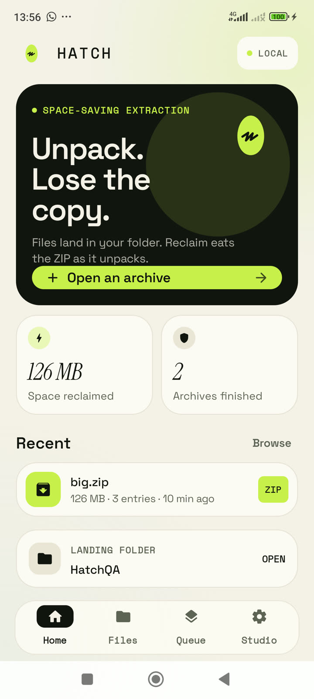
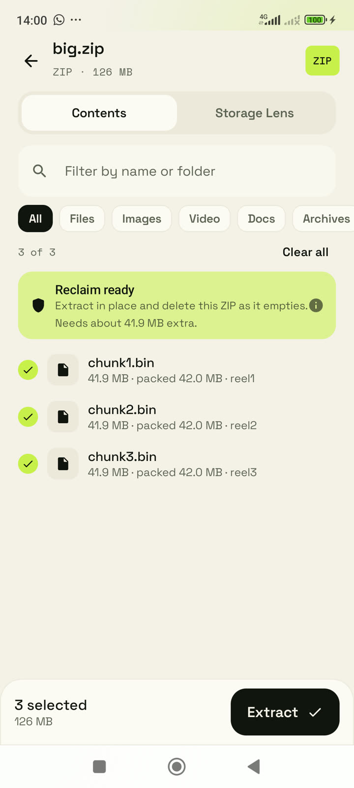
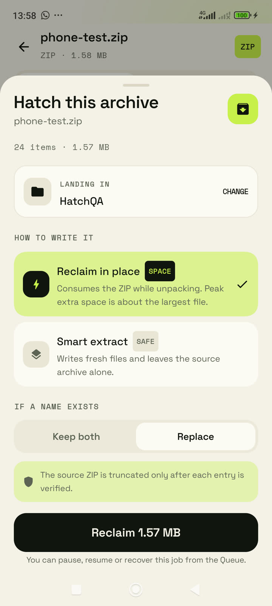
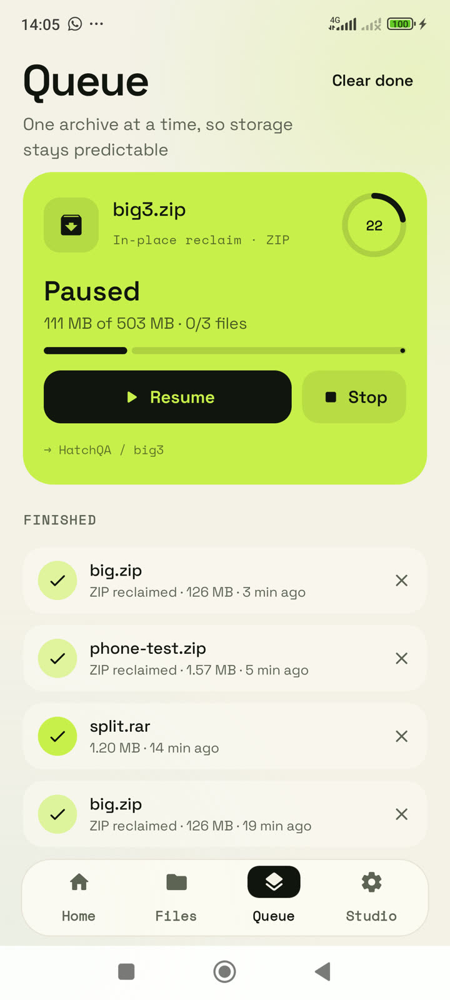

# Hatch

A premium, local-first archive extractor for Android, built around one idea:
**unpack a ZIP without keeping a second copy of it.**

Hatch pairs a Rust extraction core with Jetpack Compose and Material 3. The
default look is **Paper**, a warm light theme; Ink (dark) and system Auto are
one tap away in Studio.

<p>
  
  
  
  
</p>

## What it does

- **In-place ZIP reclaim.** Extracts a ZIP directly into the granted folder and
  consumes the source as entries are committed. Peak extra space is roughly the
  largest selected file instead of the whole archive. The source is truncated
  or deleted only after every entry is written and verified.
- **Safe fallback.** If an archive is read-only, encrypted, split, or contains
  links/unsafe paths, Hatch falls back to smart extraction: fresh files, source
  untouched.
- **Formats.** ZIP, RAR / RAR5, 7z, TAR, TAR.GZ, GZIP, XZ, Zstandard and
  Bzip2, including compressed TAR sets (`.tar.xz`, `.tar.zst`, `.tar.bz2`).
  ZIP, RAR and 7z passwords are supported.
- **Create ZIP.** Zip a folder or a multi-selection straight into the granted
  folder: DEFLATE by default, an optional AES-256 password that opens in
  ZArchiver, 7-Zip and WinRAR, and split volumes (`.z01`, `.z02` … plus the
  final `.zip`). Volumes are written into private cache first and copied into
  the destination only once the archive is complete, so a failed run can never
  leave a broken file behind.
- **Optional ads, one-time unlock.** A banner on Home, a sparse interstitial
  after every third completed job, and an opt-in rewarded video that grants
  24 hours ad-free. **Remove ads** is a one-time $4.99 purchase; once owned,
  banners, interstitials and rewarded prompts disappear. Ads never cover an
  extraction in progress and never appear inside the inspector.
- **Multipart.** Split ZIP (`.z01` + `.zip`), 7z (`.7z.001`) and RAR
  (`.partN.rar`, `.rNN`) sets are resolved through the SAF tree, staged in
  private cache, and opened with the bundled engines.
- **Pause, resume, recovery.** Jobs run in a foreground service, survive
  rotation and process death, and resume from a journal after a crash.
- **Space cleaner.** Scan the landing tree for whole ZIP/RAR/7z/TAR/GZIP
  archives, review every source and its folder, then extract and remove the
  archives in one batch. Split sets are skipped. A source is deleted only after
  every entry is confirmed; partial selections keep the archive.
- **Quick clean from the share sheet.** Share an archive from another app to
  Hatch and land directly on the extraction sheet with “Extract & free space”
  preselected when the source is writable.
- **Entry preview.** Look inside an archive before extracting: images render
  inline, text opens in a private reader, and video/PDF/audio can be handed to
  another app. Previews are capped at 24 MB, use private cache only, and respect
  archive passwords.
- **Share one entry.** Select a single file in the inspector and tap Share:
  Hatch stages just that entry in private cache and opens the Android share
  sheet, so a file can go to WhatsApp or Drive without extracting the archive
  or leaving a copy in your folder.
- **Free-space preflight.** The destination’s free bytes are checked before a
  job starts and again per queued archive. `ENOSPC` becomes an actionable
  message instead of a generic failure.
- **Batch extraction.** Select several archives in Files and hatch them in one
  queue.
- **File manager.** Browse the landing tree, search, sort, grid/list, rename,
  delete, share, and open files without a second file-manager app.
- **Storage Lens.** See packed vs unpacked size, entry mix, compression ratio
  and reclaim eligibility before extracting.
- **Password vault (optional).** Archive passwords encrypted with an Android
  Keystore AES-GCM key. Nothing leaves the device.
- **Premium UI.** Material 3, large type, generous spacing, hand-built type
  scale, no nested-card clutter, no dead screens. A custom launch splash
  stages the Hatch mark over a soft lime-to-sea gradient, then hands off to
  onboarding or Home without a white flash.

Hatch requests no storage permission: all file access goes through the Storage
Access Framework with a folder the user explicitly grants. Archives, entry
names, previews and saved passwords never leave the device. The `INTERNET` and
`ACCESS_NETWORK_STATE` permissions exist only for the Google Mobile Ads SDK and
Google Play billing; Hatch itself has no accounts, no analytics and no
first-party network calls.

## Architecture

```
Compose UI
  └─ HatchViewModel ── JobManager (foreground data-sync service, JSON journal)
        └─ NativeEngine (JNI)
              └─ Rust core (hatch_core)
                    ├─ open.rs        format sniffing and routing
                    ├─ zip_engine.rs  ZIP + AES/ZipCrypto, reclaim planner
                    ├─ rar_engine.rs  bundled UnRAR, volumes, passwords
                    ├─ sevenz_engine.rs
                    ├─ tar_engine.rs / gzip_engine.rs
                    ├─ compressed_engine.rs  XZ / Zstandard / Bzip2
                    └─ reclaim.rs     in-place truncation + journal
                          └─ Sink: SafExtractionSink → user-granted folder
```

Creating archives stays on the Kotlin side: `ZipCreator` streams SAF input
into zip4j, so a 1 GB folder is never held in memory, `ZipSplitNormalizer`
rewrites the disk-relative offsets when a split set is reopened, and `AdsManager`
plus `BillingManager` keep monetisation out of the extraction core.

The native layer only reads archive data. Writes go through a `Sink`; on
Android that sink is backed by `DocumentsContract`, so extracted files land in
the user's folder rather than in app storage. Multipart sets are the one
exception: they are copied to private cache because the engines need real
sibling paths for volume discovery.

## Build

Requirements:

- JDK 17
- Android SDK 36 (`compileSdk 36`, `targetSdk 36`, `minSdk 26`)
- Android NDK `27.2.12479018`
- Rust 1.85+ with `aarch64-linux-android` and `x86_64-linux-android` targets

```bash
rustup target add aarch64-linux-android x86_64-linux-android

export ANDROID_SDK_ROOT="$HOME/Android/Sdk"
./scripts/build-core.sh all      # builds jniLibs for arm64-v8a + x86_64
./gradlew assembleRelease        # signed APK (if keystore.properties exists)
./gradlew bundleRelease          # signed AAB for Google Play
```

`scripts/build-core.sh` refuses to package a library that embeds static bionic
and verifies that every artifact links the shared `libc.so` stub. Do not bypass
those guards; a static-libc build crashes inside scudo at runtime.

### Signing

Create `keystore.properties` in the repository root (never commit it):

```properties
storeFile=hatch-release.jks
storePassword=...
keyAlias=hatch
keyPassword=...
```

Without this file the release build is unsigned. The app is also configured for
R8 minification and resource shrinking.

### Ads and the Remove Ads purchase

Hatch ships with Google's public test ad units, so a debug build runs without an
AdMob account. Override them in `gradle.properties` (or your
`~/.gradle/gradle.properties`) before a monetised release:

```properties
HATCH_ADMOB_APP_ID=ca-app-pub-...
HATCH_ADMOB_BANNER=ca-app-pub-.../...
HATCH_ADMOB_INTERSTITIAL=ca-app-pub-.../...
HATCH_ADMOB_REWARDED=ca-app-pub-.../...
```

The one-time product is `remove_ads` (`BuildConfig.REMOVE_ADS_PRODUCT_ID`).
Create it in **Play Console → Monetise → In-app products** at $4.99; the
Settings card shows the localised Play price once the product is live. Purchases
are acknowledged immediately, re-queried from Play on every launch, and stored
on-device. The rewarded video only unlocks a local 24-hour ad-free window.

Google's test units and test cards only render on registered test devices, so a
release upload needs real ad unit IDs and a closed-testing track to exercise
billing end to end.

## QA evidence

Validated on a physical **Redmi Note 11 (2201117TY), Android 13, 1080×2400**,
plus a Pixel-class emulator, with release builds:

| Check | Result |
| --- | --- |
| 126 MB ZIP, 3 stored entries, in-place reclaim | Source deleted, 3 outputs, byte-identical |
| 503 MB ZIP, 3 stored entries, in-place reclaim | 3 outputs byte-identical (MD5 checked) |
| Pause at 111 MB of 503 MB, resume | Completed, byte-identical |
| Force-stop mid-reclaim, relaunch, resume | Recovered from journal, byte-identical |
| 3-volume RAR (`split.part1..3.rar`) | 1.2 MB entry, MD5 identical to source |
| Password RAR | Unlocked and extracted |
| ZIP/TAR inspector, selection, Storage Lens | Verified |
| Paper/Ink/Auto themes and all four tabs | Verified at 1080×2400 |
| Rust core tests | 9 passed, 0 failed |
| Space cleaner scan, 2-archive batch, source removal | 6 archives found; ZIP source deleted after all entries confirmed; outputs complete |
| Inline text and image preview | Verified on emulator, API 36 |
| Share one entry from inside a ZIP | Share sheet opened on the Redmi Note 11 with `notes.txt` (WhatsApp, Quick Share, ChatGPT listed); nothing written to the landing folder |
| Share-sheet quick clean (`ACTION_SEND`) | Sheet opens with Extract & free space; emulator, debug grant |
| Free-space preflight | Destination free/needed shown in sheet; job-level guard compiled |
| XZ, Zstandard, Bzip2, `.tar.xz` / `.tar.zst` / `.tar.bz2` | All listed and extracted by the Rust host probe |
| Create ZIP from a folder selection | 3 entries written into the granted folder |
| Create ZIP with AES-256 password | Reopened with zip4j: `encrypted=true`, AES entries, correct password extracts |
| Create split ZIP | Multi-disk end record written and normalizer unit-tested (2 tests, 0 failures) |
| Custom Hatch splash and onboarding | Verified on emulator, API 36, 1080×2400 |

Post-update and cold-start runs were also checked: the SAF grant survives an
APK update and the reclaim write path keeps working.

## Google Play checklist

- Build a signed **AAB** with `./gradlew bundleRelease` (Play does not accept
  an APK for new apps).
- `versionCode 3`, `versionName 1.2.0`; bump both for every upload.
- 64-bit ARM is included for devices; x86_64 is for emulators.
- Complete **Data safety** for the Google Mobile Ads SDK (device identifiers,
  approximate location and ad interactions may be collected by Google). Hatch
  itself collects nothing.
- Provide a privacy policy URL that names AdMob and Google Play billing.
- Declare **contains ads** and **in-app purchases** in the content rating and
  store listing. The only product is the one-time `remove_ads` item.
- Include the UnRAR notice in the listing or app; it is already exposed in
  **Studio → Open-source licenses**.
- Test the AAB with bundletool or an internal-testing track before production.

## Licensing audit

- **UnRAR** — `core/vendor/unrar_sys/vendor/unrar/license.txt`. UnRAR is
  freeware, **not OSI open source**. It may be used to extract RAR archives, but
  its license forbids using the code to build a RAR compressor. Hatch is
  extraction-only and never creates RAR files. The notice ships with the app.
- **Fonts** — Space Grotesk, Space Mono and Instrument Serif are SIL Open Font
  License 1.1; license texts are in `app/src/main/assets/licenses/`.
- **Rust crates** — `zip`, `unrar`, `unrar_sys`, `sevenz-rust2`, `jni`,
  `crc32fast` and the rest keep their upstream MIT/Apache-2.0 licenses; see
  `core/Cargo.lock` and the in-app licenses screen.
- **Hatch application code** — no license has been chosen for the original
  code in this repository. Add one before accepting outside contributions.

## Known limitations

- In-place reclaim is **ZIP only** and is refused for encrypted ZIPs,
  symlinks, unsafe paths, read-only documents and partial selections.
- RAR, 7z and multipart inputs are always staged or extracted through the
  normal path; only ZIP gets zero-copy reclaim.
- Archive creation is ZIP-only; Hatch never writes RAR, 7z, TAR or compressed
  TAR files.
- Split creation writes classic `.z01`…`.zip` sets. A volume size larger than
  the payload produces a single `.zip`, which is expected behaviour, not a
  failure.
- Ads are disabled while Remove Ads is owned or the rewarded window is active,
  but a previously cached banner may stay on screen until Home recomposes.
- Inline preview is capped at 24 MB per entry. Larger images, video or PDFs
  report “too large for a quick preview” and should be extracted. Sharing is
  not capped; the staged copy is replaced on the next share.
- Removing the source requires write access to that archive. Read-only shares
  still extract normally, but Hatch keeps the original and explains why.
